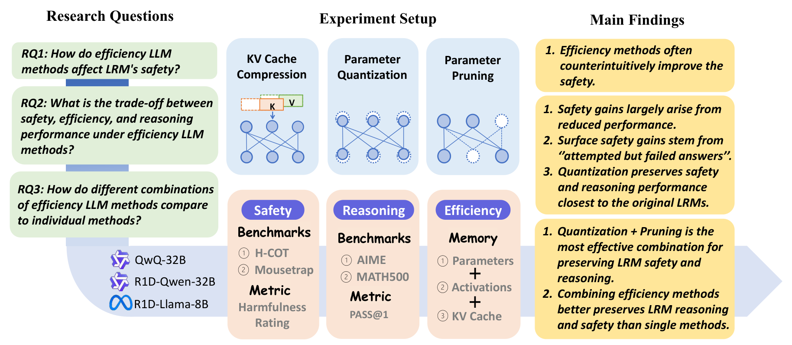

# 🧠 LRM-Efficiency-Safety

Code for **On the Efficiency-Safety Dilemma in Large Reasoning Models**.

> 🎉 **Accepted to the EMNLP 2026 Main Conference!**

We study how quantization, pruning, and KV cache compression affect reasoning,
jailbreak vulnerability, and inference efficiency.



## 🔍 Research questions and findings

**🛡️ RQ1: How do efficiency methods affect LRM safety?**
Their effects depend on the model and compression method. Compression often
reduces harmful outputs, but some configurations increase harmfulness.

**⚖️ RQ2: What is the trade-off between safety, efficiency, and reasoning?**
Apparent safety gains often reflect degraded reasoning: models attempt to comply
but fail to produce valid harmful answers, rather than becoming better aligned.
Quantization generally preserves the original safety and reasoning behavior
most closely; KV cache compression causes the largest capability degradation.

**🧩 RQ3: How do combined efficiency methods compare with individual methods?**
Within the evaluated models and memory budgets, quantization combined with
pruning offers the most favorable overall trade-off. Combined methods can
preserve reasoning and safety behavior with lower memory use than individual
methods.

## 🚀 Usage

See [the usage guide](docs/USAGE.md) for installation, compression, safety and
reasoning evaluation, memory profiling, and representational drift analysis.

Model checkpoints, benchmark data, and experimental outputs are obtained or
generated locally. Python code is licensed under Apache-2.0; see
[third-party notices](THIRD_PARTY.md) for inherited code and prompt licenses.

## 📚 Citation

```bibtex
@article{yang2026efficiency,
  title={On the Efficiency-Safety Dilemma in Large Reasoning Models},
  author={Yang, Yifei and Cao, Zouying and Wang, Xingrui and Zhou, Xiao and Li, Yuexian and Yang, Dongjie and Zhao, Hai},
  journal={arXiv preprint arXiv:2609.23587},
  year={2026}
}
```
